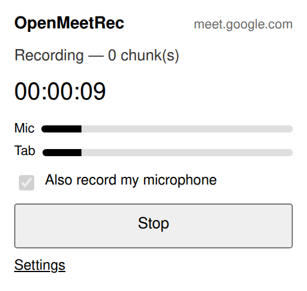

# OpenMeetRec

An open source, privacy-first browser extension that records the audio of your web
meetings, your microphone and every remote participant, on any video conferencing
platform, then transcribes it with the speech API of your choice (Mistral Voxtral or
OpenAI Whisper) and exports the result as Markdown.

No bot joining the call, no mandatory cloud service, no network request you didn't
trigger yourself.

[Install from the Chrome Web Store](https://chromewebstore.google.com/detail/openmeetrec/djfhjbamifmdfndaekdaigmlhdblhaif)



## Why

There's no shortage of meeting recorders and transcription bots, but most of them are
tied to one specific video conferencing tool, join the call as a visible participant, or
route your audio through someone else's cloud. There wasn't a simple, open source option
that just works wherever you already are: OpenMeetRec captures the tab audio directly, so
it works with any video conferencing tool as long as you're using it in Chrome.

It's also deliberately scoped to transcription only, no automatic summary. In my
experience, a transcript turned straight into a summary without context (the project
brief, the notes from a previous meeting) comes out shallower than one written with that
context in hand. So this extension focuses on getting a clean transcript, live and right
after the meeting ends, and leaves what you do with it to you and whatever tool you
already use for that.

## How it works

- Click the extension icon to start recording; a red dot on the icon and a "REC" badge
  show it's running, even after you close the popup.
- Open a page OpenMeetRec recognizes as a meeting (Meet, Teams, Zoom, Jitsi, Whereby,
  Webex...) and it reminds you with a system notification to hit record. Nothing starts
  automatically, and the URL list is fully editable in settings.
- Audio is mixed from your microphone and the tab (remote participants) and chunked
  locally while recording, so memory use doesn't grow with meeting length.
- Each chunk is sent to the transcription provider you configured as the meeting goes.
  If a chunk fails (network blip, rate limit), a retry button reruns the pipeline on the
  same session afterwards, no need to record again.
- Diarized transcripts group consecutive segments from the same speaker into a single
  paragraph per turn, instead of one paragraph per raw ~10 second API segment.
- Once merged, the transcript is exported as a Markdown file, with no server in between
  beyond the API you chose.
- No video conferencing host permissions are requested: capture relies on `activeTab`,
  granted only for the tab you clicked the icon on; the meeting reminder needs `tabs` to
  read that tab's URL (compared against your patterns, then discarded) and
  `notifications` to show the reminder. See
  [`docs/permissions-audit.md`](docs/permissions-audit.md) for the full breakdown of
  every permission the extension asks for and why.

## Status

MVP, Chromium only. Firefox is out of scope for now, though the capture layer is built
behind an interface so it can be added without rewriting the rest.

Tested end to end: real meetings recorded start to finish, and the transcription
pipeline checked against the real Mistral (with diarization) and OpenAI APIs.

## Development

```bash
npm install
npm test          # unit tests (Vitest) — pure logic, no browser
npm run typecheck
npm run build     # outputs dist/, loadable via chrome://extensions (developer mode)
npm run test:e2e  # integration: full session in Chromium (~1 min)
```

The build writes an unpacked extension to `dist/`: enable developer mode in
`chrome://extensions`, then "Load unpacked" and point it at `dist/`.

### Running the integration tests

They need an X display (headful) and Chromium. On a headless machine, a VNC server is
enough, no need for xvfb:

```bash
DISPLAY=:1 npm run test:e2e
```

Playwright normally downloads its own Chromium (`npx playwright install chromium`). If a
build is already present on the machine at a different revision than the one Playwright
expects, point at it instead of re-downloading:

```bash
OMR_CHROMIUM=~/.cache/ms-playwright/chromium-1232/chrome-linux64/chrome DISPLAY=:1 npm run test:e2e
```

### Validating against a real API (manual, outside CI)

`npm test` and `npm run test:e2e` never call a real API: the project rule is a mock
provider in CI, always. Two manual scripts exist to check the pipeline against a real
Mistral/OpenAI response. Neither is ever run by `npm test` or by CI, and both cost money
on every run.

| Script | File | Path under test |
|---|---|---|
| `npm run test:real-api` | `tests/manual/real-api.manual.ts` | **chunked** — splits the audio with `ffmpeg`, sends every chunk, checks that returned timestamps stay inside each chunk's bounds (an absolute timestamp or a different unit would silently break reassembly) |
| `npm run test:one-shot` | `tests/manual/one-shot.manual.ts` | **single request** — sends the whole file, reports accept/refuse with the API's own error body, and asserts the transcript covers ≥98% of the audio (an API can accept an over-long file and transcribe only its beginning, without erroring) |

Both write the resulting Markdown to `test-results/` (git-ignored) for review. Nothing is
committed, nothing is logged; the API key is only ever used in the HTTP header.

#### API keys

**Keys live in `.env.local` at the repository root**, git-ignored through the `.env.*`
rule in `.gitignore`. Not in `~/.config`, not exported from your shell profile.

```bash
# .env.local — git-ignored, never committed
MISTRAL_API_KEY=...
OPENAI_API_KEY=...
```

```bash
set -a && . ./.env.local && set +a
OMR_TEST_AUDIO=tests/manual/audio/meeting-40min.webm npm run test:one-shot
OMR_TEST_PROVIDER=openai OMR_TEST_AUDIO=tests/manual/audio/short.webm npm run test:real-api
```

Variables: `OMR_TEST_AUDIO` (required), `OMR_TEST_PROVIDER` (default `mistral`),
`OMR_TEST_MODEL`, `OMR_TEST_ENDPOINT` (for the `custom` provider), and
`OMR_TEST_CHUNK_DURATION` / `OMR_TEST_OVERLAP` (seconds — `test:real-api` only, useful to
force several chunks out of a short file without touching the product's defaults).
`OMR_TEST_DIARIZE` differs between the two: `=1` opts in for `test:real-api`, while
`test:one-shot` diarizes by default and takes `=0` to opt out — consistent diarization is
the whole point of the single-request path.

#### Test audio must look like a real recording

Test audio goes in `tests/manual/audio/` (git-ignored). It has to carry the quirks of what
`MediaRecorder` produces, or the test validates something easier than what we ship: a
**live** WebM, with no `Duration` in the header and a `Segment` of unknown size. A plain
`ffmpeg` conversion writes a *seekable* file with a duration and a cue index, which a
server may well accept where ours fails. `-live 1` is what reproduces it:

```bash
ffmpeg -i source.opus -vn -ac 1 -ar 48000 -c:a libopus -b:a 128k \
       -map_metadata -1 -f webm -live 1 tests/manual/audio/meeting-40min.webm
```

Those settings match a real capture: Opus, 48 kHz, mono, ~131 kbps (≈58 MB/hour). Verify
before trusting a result — `ffprobe -v error -show_entries format=duration -of csv=p=0 file`
must print `N/A`, and `xxd -l 48 file` must show a `Segment` of unknown size
(`1853 8067 01ff ffff ffff ffff`).

#### Measured limits

These probes are where `src/providers/limits.ts` gets its numbers, which in turn decide
per provider and model whether a recording is sent in one request or chunked. Provider
documentation is not reliable enough on its own — Mistral's "known limitations" page
claims 60 minutes while its Transcribe 2 page claims 3 hours. Measured on 2026-09-08 and
2026-10-22:

| Provider / model | Result |
|---|---|
| `mistral` / `voxtral-mini-2602` (alias `voxtral-mini-latest`) | 1 h 29 min accepted in one request, 99.9% covered, no silent truncation. Speaker IDs come back as `speaker_N` strings |
| `mistral` / `voxtral-mini-transcribe-3`, `voxtral-small-transcribe-3` | 65,536-token context window **that includes the output**: 12.5 tokens per second of audio plus ~5 per second of transcript. 1 h 29 refused upfront (`HTTP 400 — Prompt 67130 > 65536 maximum context length`); 1 h 25 **accepted but silently truncated** after 5 min 18 (`total_tokens` = 65536, `finish_reason` null as on a complete response); 45 min covered 100%. Capped at 45 min, and a response that fills the window is rejected and re-run in chunks. Segments may have zero duration |
| `openai` / `whisper-1` | 17 s accepted; 37 MiB refused with `HTTP 413 — Maximum content size limit (26214400) exceeded`, i.e. exactly 25 MiB of multipart body |

## Design choices

- Chunking, merging, config, formatting, and retry policy import neither `chrome` nor
  the DOM, so the fragile logic is covered by unit tests that run in milliseconds.
- Capture is abstracted behind a `CaptureStrategy` interface, leaving room for a Firefox
  implementation later without touching the rest of the pipeline.
- Chunks are produced while recording, not afterwards, so memory use doesn't depend on
  meeting length.
- Timestamped segments are always requested, regardless of diarization; that's what
  makes it possible to drop duplicated text at chunk boundaries without an extra LLM
  pass.

## Credits

The chunking/merge pipeline design is inspired by a Python project of mine called
`supervoxtral`, ported to TypeScript. Unlike supervoxtral, this project stops at
transcription and doesn't include a second, LLM-driven summarization step; that's
intentionally left to whatever tool you use downstream.

## Privacy

See [`PRIVACY.md`](PRIVACY.md).

## License

MIT.
